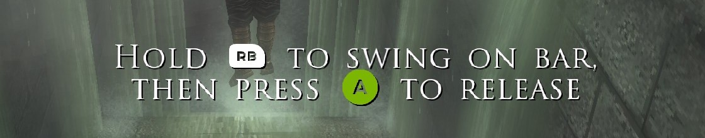
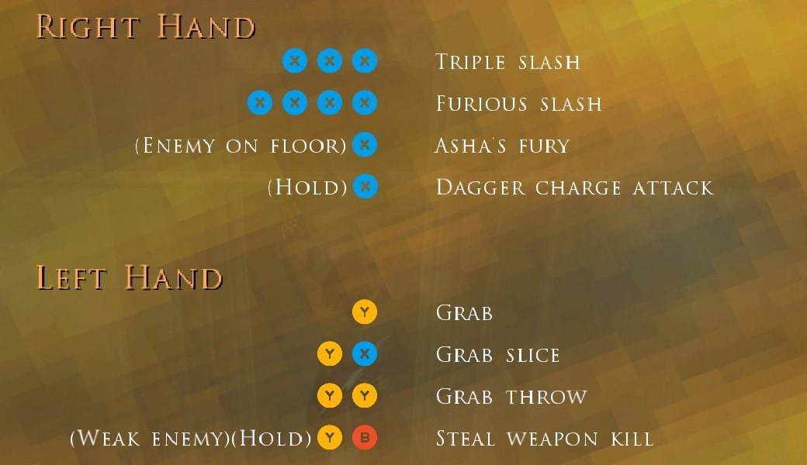
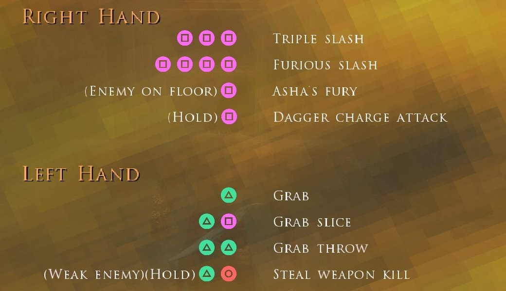
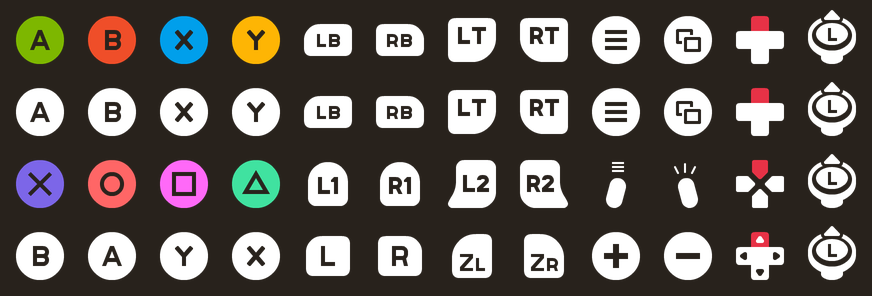

<h1 align="center">pop-pad</h1>

<p align="center">
  Controller support for <b>Prince of Persia: The Two Thrones</b> on PC.<br>
  Any gamepad works, and the prompts show its buttons instead of keyboard keys.
</p>

<p align="center">
  <a href="https://github.com/Okwizi/pop-pad/actions/workflows/ci.yml"></a>
  <a href="LICENSE"></a>
  
  
</p>

<p align="center">
  
</p>

**pop-pad** is a small mod for the Steam release of *Prince of Persia: The Two Thrones*. It is one
file, `dinput8.dll`, that sits next to the game's executable and makes the game's own Xbox
controller code work for any XInput controller, then swaps the keyboard names in the prompts for
button icons.

> **No game files are included and none are changed.** You need your own copy of the game. The
> game's program and data files are never modified: the mod works in memory and hands the game
> edited copies of two of its files, kept in a folder of their own (see
> [How it works](#how-it-works)). The one thing it writes is the control bindings of your profiles,
> and each original is kept as a backup.
> This project is not affiliated with or endorsed by Ubisoft. *Prince of Persia* is a trademark of
> Ubisoft Entertainment.

<p align="center">
  
  
</p>

## Contents

- [The problem](#the-problem)
- [What works](#what-works)
- [Requirements](#requirements)
- [Install](#install)
- [Controls](#controls)
- [Settings](#settings)
- [Button icons](#button-icons)
- [Troubleshooting](#troubleshooting)
- [Reporting a bug](#reporting-a-bug)
- [Building from source](#building-from-source)
- [Tests and checks](#tests-and-checks)
- [How it works](#how-it-works)
- [Work in progress](#work-in-progress)
- [Contributing](#contributing)
- [Credits](#credits)
- [License](#license)

## The problem

The game has complete Xbox controller support, but it switches it on for exactly one hardware ID
(a wired Xbox 360 pad), and it only writes the gamepad bindings into a profile when that pad is
plugged in as the profile is created. Any other controller is treated as an unbound 2005-era
joystick: the buttons do nothing, the triggers share one axis, and the on-screen prompts name
keyboard keys such as `[Space]` even while you hold a pad.

That includes controllers that look like an Xbox pad to everything else: PlayStation and Switch pads
through Steam Input, 8BitDo pads, and any XInput pad with a different ID. pop-pad removes the
one-ID limit.

## What works

| Feature | Status | Notes |
|---|---|---|
| Any XInput pad drives the game's own Xbox controller code | Works | Tested with an 8BitDo Ultimate 2C on its 2.4 GHz dongle |
| Existing profiles get the default Xbox layout | Works | The original `Profile.DAT` is kept beside the edited one |
| Menus, gameplay and prompts follow the pad | Works | Played through menus and gameplay |
| Round-stick diagonals reach full speed | Implemented | `StickSaturation` in `poppad.ini`; the default of 75 is in use |
| Button icons instead of text in prompts, the Combo List and the controls screen | Works | Xbox and PlayStation sets seen on screen |
| Icons without the game's `[ ]` around them | Works | Only on the exact game build listed under [Requirements](#requirements) |
| Switch and generic icon sets | Built, not yet seen on screen | See [Button icons](#button-icons) |
| Controller switched on after the game has started | Should work, untested | The game's XInput code copes with an empty slot |
| **Steam Input switched on for the game** | **Not working yet** | No input reaches the game. See [Work in progress](#work-in-progress) |
| Your own icon artwork | Possible by hand, no tooling yet | See [Work in progress](#work-in-progress) |
| Sands of Time, Warrior Within | Not started | See [Work in progress](#work-in-progress) |

## Requirements

- Windows, with the Steam release of *Prince of Persia: The Two Thrones* (Steam app 13530).
- An XInput controller: an Xbox pad, or any controller that appears as one (Steam Input's virtual
  pad, 8BitDo and similar in X-input mode).
- Steam Input **switched off** for this game for now (see [Install](#install)).

**Tested game build.** The icon brackets are removed by patching two routines inside
`POP3.EXE`, which only works on the build it was written against:

| File | Size | SHA-1 |
|---|---|---|
| `POP3.EXE` (Steam) | 6,336,512 bytes | `cd1620bf2bf6462da326f7cb4081d185da21c3e2` |

On any other build the mod checks the code it expects, finds a mismatch and leaves it alone:
everything else keeps working and the icons simply stay inside `[ ]`. Everything else in pop-pad
finds its places by name and does not depend on the executable.

## Install

A first release has not been published yet. Until then, [build it from source](#building-from-source)
and use the folder that `tools/package.sh` makes. Once releases exist, they are on the
[Releases page](https://github.com/Okwizi/pop-pad/releases) as `pop-pad-<version>.zip`.

1. In Steam, right-click the game, **Manage**, **Browse local files**.
2. Extract the zip there so that `dinput8.dll` sits next to `POP3.EXE`. You get `dinput8.dll`,
   `poppad.ini` and a `poppad` folder (the button icons).
3. In Steam, right-click the game, **Properties**, **Controller**, and set
   **Disable Steam Input**. This is needed until Steam Input support is fixed.
4. Connect your controller and start the game from Steam as usual. The game opens its own
   configuration window first, as it always does.

The first start adds the game's default Xbox layout to every profile that has no pad bindings, and
keeps each original as `Profile.DAT.before-pop-pad` beside it.

**To remove it,** delete `dinput8.dll`, `poppad.ini` and the `poppad` folder from the game folder.
To also undo the profile change, copy a `Profile.DAT.before-pop-pad` back over its `Profile.DAT`.

Do not combine it with Xidi, XInput Plus or Pad-of-Thrones: they replace the same file or solve the
same problem a different way.

## Controls

The layout written into profiles that had no pad bindings is the game's own default for an Xbox
pad:

| Control | Action |
|---|---|
| Left stick | Move |
| Right stick | Camera |
| **A** | Roll, jump, action |
| **B** | Pick up, throw, drop |
| **X** | Dagger attack |
| **Y** | Second weapon, grab |
| **LB** | Rewind, slow down |
| **RB** | Wall run, block, swing |
| **LT** | Landscape view |
| **RT** | First-person view |
| **Back** | Navigation map |
| **Start** | Pause |
| D-pad | Menu navigation |

Change them in the game under **Options**, **Controls-Gamepad**; pop-pad only supplies the
starting point.

## Settings

`poppad.ini` sits next to `dinput8.dll`. Every line is optional.

| Section | Setting | Default | What it does |
|---|---|---|---|
| `General` | `Log` | `1` | Write `poppad.log` into the game folder on every start. Attach it to bug reports. |
| `Input` | `NativeXInput` | `1` | Send XInput controllers to the game's own Xbox code. `0` restores the game's stock behaviour. |
| `Input` | `AddDefaultBindings` | `1` | Add the default layout to profiles without pad bindings. |
| `Input` | `StickSaturation` | `75` | Percent of stick travel that counts as fully pushed, 30 to 100. The game reads each axis on its own, so a round stick never reaches full speed on a diagonal at 100. |
| `Glyphs` | `Enabled` | `1` | Show button icons instead of text. Needs the `poppad\glyphs` folder. |
| `Glyphs` | `Style` | `auto` | `auto`, `xbox`, `playstation`, `switch` or `generic`; or the name of your own set. |

## Button icons

<p align="center"></p>

<p align="center"><sub>Top to bottom: Xbox, generic, PlayStation, Switch.</sub></p>

With `Style=auto`, the set follows the controller that is connected:

| Controller (by USB vendor) | Set |
|---|---|
| Sony | `playstation` |
| Nintendo | `switch` |
| Another maker, not Microsoft | `generic`: Xbox letter positions without Xbox colours |
| Microsoft, or nothing found | `xbox` |

Steam Input adds a virtual Xbox pad next to the real controller, so the real one decides.

Icons are drawn at one and a half times the height of a capital letter. Keyboard names keep their
`[ ]`. Only the names of pad inputs are replaced.

The icon pictures are from [Kenney's Input Prompts](https://kenney.nl/assets/input-prompts), which
are public domain (CC0); see [`assets/glyphs/SOURCE.md`](assets/glyphs/SOURCE.md). PlayStation,
Xbox and Nintendo button shapes are trademarks of their owners.

**Your own icons.** A set is 24 PNG files of 128 x 128 pixels, one for each input, named like the
files in [`assets/glyphs/xbox`](assets/glyphs/xbox). The build script packs a folder of them into
the one file the mod reads:

```bash
python3 tools/build_glyphs.py --icons my_icons --name mine
```

Copy `dist/poppad/glyphs/mine.tga` into the game's `poppad\glyphs` folder and set `Style=mine`.
This path uses the same loading code as the shipped sets but has not been tried in the game yet;
easier tooling is [planned](#work-in-progress).

## Troubleshooting

**The controller does nothing.** Check that Steam Input is disabled for the game (see
[Install](#install)), and that `poppad.log` exists in the game folder after a start. If the log
is missing, `dinput8.dll` is not next to `POP3.EXE` (or `Log` is set to `0`).

**"Use safe mode settings?" appears when the game starts.** The game leaves a marker file when it
is closed in an unclean way (a crash, or a killed process). Answer **No**, or delete the file
`PrinceSM` from the game folder.

**Prompts show `[A]`-style text or boxes, not icons.** Open `poppad.log` and look for the lines
below.

| Message in `poppad.log` | Meaning | What to do |
|---|---|---|
| `icons: ... is missing or not a 1024x512 32-bit TGA; icons disabled` | The `poppad\glyphs` folder or the chosen set is missing | Copy the whole `poppad` folder next to `dinput8.dll`; check `Style` |
| `brackets: this game build is not the one pop-pad knows; icons keep their brackets` | Another build of `POP3.EXE` | Cosmetic only; icons work, inside `[ ]` |
| `font <name>: not understood; left alone` | A font file in a layout the mod does not know | Report it with the log |
| `profile <path>: ... left alone` | A profile the mod could not safely edit | Set the bindings in the game's controls screen |
| `... hook: FAILED` | The executable is not the expected one, or another mod got there first | Remove other `dinput8.dll` mods |

**Known issues**

- **Steam Input on:** no input reaches the game; see below.
- **Steam overlay:** Shift+Tab does not open it in this game. The cause is not known.
- **Menus at 3840 x 2160** are shifted right and clipped; they are fine at 1920 x 1080 and
  1024 x 768. The cause has not been investigated yet (the game's own behaviour has not been ruled
  out). Use a lower resolution in the game's options.
- An unbound control on the controls screen can show a tiny mark where an icon would go (seen on
  *Walk Toggle*). Not yet looked into.
- The space around icons in prompts is slightly wider than it needs to be.

## Reporting a bug

1. Update to the latest release and try again.
2. Search the [issues](https://github.com/Okwizi/pop-pad/issues) for your symptom.
3. Open a [new issue](https://github.com/Okwizi/pop-pad/issues/new/choose) and attach `poppad.log`
   from the game folder, taken right after closing the game. Say which controller you use, how it
   is connected, and whether Steam Input is on.

## Building from source

The game is a 32-bit program, so the DLL is built as 32-bit. It is cross-compiled on Linux with
MinGW-w64. On Debian or Ubuntu:

```bash
sudo apt install g++-mingw-w64-i686 cmake ninja-build python3-venv shellcheck
git clone https://github.com/Okwizi/pop-pad
cd pop-pad
python3 -m venv .venv && . .venv/bin/activate
pip install -r requirements-dev.txt
```

Build the DLL, the icon atlases and the zip:

```bash
cmake -S . -B build -G Ninja -DCMAKE_TOOLCHAIN_FILE=cmake/mingw-i686.cmake -DCMAKE_BUILD_TYPE=Release
cmake --build build
python3 tools/build_glyphs.py
tools/package.sh
```

The zip lands in `dist/`. `tools/build_glyphs.py` packs the PNG sets in `assets/glyphs` into
`dist/poppad/glyphs`; `tools/build_glyphs.py --pack assets/vendor/kenney` first re-picks them from
Kenney's pack, unpacked there. Building on Windows itself has not been tried.

## Tests and checks

One command runs everything CI runs: formatting, linting, the build with warnings as errors, and
the unit tests.

```bash
tools/check.sh          # report
tools/check.sh --fix    # let clang-format and ruff rewrite files
```

| Check | Tool | Covers |
|---|---|---|
| C++ formatting | `clang-format`, version pinned, config in `.clang-format` | `src/`, `tests/native/` |
| Python lint and format | `ruff`, config in `pyproject.toml` | `tools/`, `tests/` |
| Shell lint | `shellcheck` | `tools/*.sh`, `tools/dev/*.sh` |
| Build | MinGW-w64 with `-Wall -Wextra -Werror` | the DLL |
| C++ unit tests | `tests/native`, host compiler with AddressSanitizer and UBSan | font table parsing and writing, adding icon characters to a font, rewriting the game's name file inside its archive |
| Python unit tests | `pytest`, `tests/` | the icon atlas and its file format, and that the constants shared by the C++ and the tools, and the settings in `poppad.ini`, agree |

The game's own files cannot be shipped, so the tests build their inputs themselves from the file
formats written down in `src/font_file.h` and `src/font_patch.cpp`. What the tests cannot cover
(anything that needs the running game) is under [Work in progress](#work-in-progress).

### Remote test rig

`tools/dev` drives the game on a Windows PC over SSH. With `[Dev] Commands=1` the DLL runs scripts
dropped next to the game (pad presses, key presses, in-game screenshots), and with `VirtualPad=1`
it supplies a scripted pad so no controller has to be connected. The rig is for development only
and is not part of a release.

```bash
cp tools/dev/local.env.example tools/dev/local.env   # then fill it in
tools/dev/deploy.sh devpad
tools/dev/launch.sh
tools/dev/send.sh 'tap START; sleep 1500; shot pause'
tools/dev/send.sh quit
```

Always leave the game with `quit`: killing the process makes its next start stop at the "safe mode"
prompt described under [Troubleshooting](#troubleshooting).

## How it works

`dinput8.dll` in the game folder loads ahead of the system copy and forwards to it. From there:

- **Device list.** XInput-class devices are hidden from the game's DirectInput enumeration and one
  stand-in device with the accepted hardware ID is listed instead. The game then drops DirectInput
  for that pad and polls XInput. The hook sits above Steam's own DirectInput filter.
- **XInput.** The game looks XInput up by name at start-up. Those lookups are answered with
  wrappers that pick whichever XInput slot is live and widen the stick range.
- **Profiles.** `Profile.DAT` files with no bindings for the pad get the same 22 records the game
  writes for a new profile. The format is documented at the top of `src/profile_fix.cpp`.
- **Icons.** The game is handed edited copies of its font tables and of its input names, kept in
  `poppad\cache`: each pad input's name becomes one extra character, and that character's picture
  comes from `poppad\glyphs\<style>.tga`, joined onto the font's first texture page when the game
  draws with it. See `src/glyphs.cpp`.
- **Brackets.** The game wraps every input name in `[ ]`. Two routines in `POP3.EXE` are patched in
  memory so that an icon comes back bare. This is the only part tied to an exact build, and it
  checks the bytes it expects before touching anything.

| Part | Files |
|---|---|
| Entry point, settings, DirectInput exports | `src/main.cpp`, `src/dinput8.def` |
| Stand-in device and device list | `src/di_hook.cpp` |
| XInput wrappers | `src/xi_hook.cpp` |
| Profile editing | `src/profile_fix.cpp` |
| Font tables, name file, redirected file reads | `src/font_file.*`, `src/font_patch.cpp`, `src/fs_hook.cpp` |
| Icon texture and characters | `src/glyphs.cpp`, `src/icons.*`, `src/d3d_hook.cpp` |
| Bracket removal | `src/brackets.cpp` |
| Hooking helpers, log | `src/iat.cpp`, `src/log.cpp` |
| Development command channel | `src/cmd.cpp` |
| Icon artwork and its build script | `assets/glyphs`, `tools/build_glyphs.py` |

## Work in progress

**Steam Input first.** The aim is for this to work the way Steam players expect: switch Steam Input
on, pick any controller, and it works with the right icons. Today it does not: with Steam Input on
for the game, no input reached it in the one test so far, while the same controller works with it
off. The cause is not known. Things to check:

- [ ] Which controller configuration Steam really applies to the game (per controller type or per
      device), since one test showed a keyboard-and-mouse layout being assigned
- [ ] Whether the game's very early lookup of `XInputGetState` happens before Steam installs its
      own XInput hook
- [ ] Why the Steam overlay does not open in this game
- [ ] Controller hot-plug, with and without Steam Input
- [ ] Linux, Proton and Steam Deck: untested; the DLL would need `WINEDLLOVERRIDES="dinput8=n,b"`

**Your own icons.** Packing a folder of PNGs already works (see [Button icons](#button-icons)).
Still to do:

- [ ] A per-input override: replace one icon without supplying a whole set
- [ ] Choosing icon size and spacing from `poppad.ini`
- [ ] Verifying a custom set in the game, and documenting the artwork guidelines (margins, colours)
- [ ] The Switch and generic sets on screen

**More games.** *Prince of Persia: The Sands of Time* and *Warrior Within* have the same kind of
controller problem. Neither has been started. The font and input-name mechanisms are likely to
differ per game, so each needs its own look at the executable.

**Menus at 4K.** Find out why the game's menus are shifted and clipped at 3840 x 2160, and whether
pop-pad can fix it.

**Tests and tooling.** Formatting, linting and unit tests exist (see
[Tests and checks](#tests-and-checks)); more is wanted:

- [ ] Move the profile editor's logic (`src/profile_fix.cpp`) behind a function that takes bytes, so
      it can be tested like the font code
- [ ] Test the bracket patch's byte check against synthetic code, so a wrong signature is caught
- [ ] Static analysis (`clang-tidy` or `cppcheck`) once it runs cleanly against the MinGW headers
- [ ] `shfmt` for the shell scripts
- [ ] Coverage reporting
- [ ] A Windows smoke test: load the DLL on a runner and check that it initialises
- [ ] Automated in-game screenshot checks on the remote rig

**Release.** The first release, and an installer or launcher that finds the game folder, so that
setup is a single step.

## Contributing

Issues and pull requests are welcome. The short version:

- Work goes on a feature branch (`feature/<what>`, `fix/<what>`), and a pull request into
  `develop`. Only `develop` goes into `master`, which is where releases come from. History is
  linear: pull requests are rebased, never merged or squashed.
- `tools/check.sh` must pass; CI runs the same steps.
- Commit messages follow [Conventional Commits](https://www.conventionalcommits.org):
  `feat(icons): ...`, `fix(profiles): ...`, `docs: ...`.
- Never add game files, dumps or other copyrighted assets.

See [CONTRIBUTING.md](CONTRIBUTING.md) for the details.

## Credits

- **Kenney**: [Input Prompts](https://kenney.nl/assets/input-prompts), the controller icons (CC0).
- **Ubisoft**: the game.
- [SpartanPort](https://github.com/FelipePrado0/SpartanPort): the layout of this README, and the
  aim of a mod that is easy to set up for people who already own the game.
- Built with [MinGW-w64](https://www.mingw-w64.org), [CMake](https://cmake.org),
  [clang-format](https://clang.llvm.org/docs/ClangFormat.html), [Ruff](https://docs.astral.sh/ruff/),
  [pytest](https://pytest.org) and [Pillow](https://python-pillow.org).

## License

GNU GPL v3 or later ([LICENSE](LICENSE)). The icon artwork is CC0 and keeps that licence.
